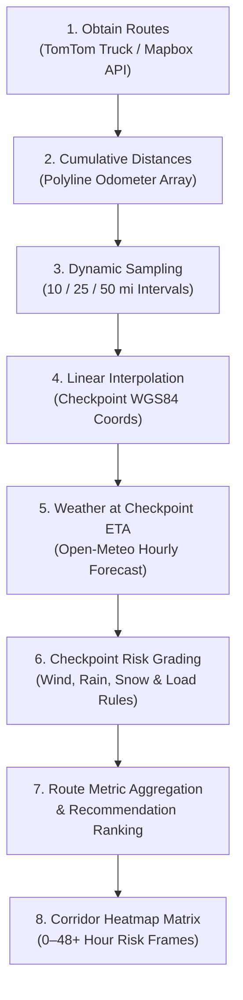

# Weather-Aware Truck Routing

A full-stack, production-ready logistics application that helps commercial truck drivers and fleet dispatchers choose the safest route based on real-time and forecasted weather hazards, cargo load weight, and travel time.


---

## Features

- **Multi-Route Truck Analysis**: Generates up to 3 distinct truck corridors using commercial vehicle routing (TomTom Truck Routing with physical clearance and axle-weight regulations, with Mapbox Directions fallback).
- **Dynamic Checkpoint Sampling**: Automatically samples the route corridor every 10, 25, or 50 miles based on total trip distance:
  - $\le 20\text{ mi} \to \text{distance} / 2$
  - $20\text{–}100\text{ mi} \to 10\text{ mi}$
  - $100\text{–}200\text{ mi} \to 25\text{ mi}$
  - $> 200\text{ mi} \to 50\text{ mi}$
- **Checkpoint ETA Weather Forecasts**: Queries Open-Meteo hourly forecasts at each checkpoint's exact estimated arrival time ($\text{ETA} = \text{departure} + \text{distance} / \text{speed}$).
- **Load-Aware Risk Assessment**:
  - **Wind**: `<25 mph` (Low), `25–34 mph` (Moderate), `35–44 mph` (High), `45–54 mph` (Severe), `≥55 mph` (No Travel).
  - **Rain**: `<0.10 in/hr` (Low), `0.10–0.25 in/hr` (Moderate), `0.25–0.50 in/hr` (High), `0.50–1.00 in/hr` (Severe), `>1.00 in/hr` (No Travel).
  - **Snow**: `<0.5 in/hr` (Low), `0.5–1.0 in/hr` (Moderate), `1.0–2.0 in/hr` (High), `2.0–3.0 in/hr` (Severe), `>3.0 in/hr` (No Travel).
  - **Load Overrides**:
    - $\ge 55\text{ mph} \to$ **No Travel** for any load.
    - $45\text{–}54\text{ mph} + >30,000\text{ lb} \to$ **No Travel**.
    - $35\text{–}44\text{ mph} + >40,000\text{ lb} \to$ **Severe**.
- **Deterministic Route Recommendation**:
  Ranks corridors strictly by:
  1. Fewest **Severe miles**
  2. Fewest **High miles**
  3. Lowest **average risk score**
  4. Shortest **travel times**
  5. Shortest **total distance**
     _(Any route with `no_travel_miles > 0` is disqualified from recommendation per the strict No-Travel safety rule)._
- **0–48+ Hour Corridor Heatmap**: WebGL-accelerated continuous weather heatmap layer visualizing atmospheric risk across the transportation corridor.
- **Interactive Forecast Timeline**: Scrub through hours $0\text{ to }48+$ with live checkpoint highlighting, arrival status, and real-time corridor heat updates.
- **1-Hour Analysis Caching**: Request-level deduplication and SHA-256 hash caching scoped by anonymous client ID.

---

## Architecture

```text
React 19 + TypeScript + MapLibre GL
  │  1. Location Search / Map Pin Picker
  │  2. GET /api/v1/routes/plan/?origin_lat=...&dest_lat=...
  ▼
Django 6 + DRF
  ├── API View & Serializers (validation, coordinates, departure UTC, load weight)
  ├── Services:
  │     ├── Routing (TomTom Commercial Truck API / Mapbox fallback)
  │     ├── Weather (Open-Meteo batch hourly forecasts)
  │     └── Cache (1-hour hash analysis reuse in SQLite / Postgres)
  └── Pure Python Domain Layer:
        ├── geo.py (polyline odometer & segment interpolation)
        ├── risk.py (weather & load-aware risk grading)
        ├── checkpoints.py (ETA calculation & checkpoint generation)
        ├── aggregation.py (distance-weighted risk mile metrics)
        ├── ranking.py (recommendation ordering)
        └── heatmap.py (corridor coordinate deduplication & intensity matrices)
```

---

## Core Pipeline & Algorithmic Flow

The application executes a rigorous 8-step pipeline to transform geographic coordinates into actionable, weather-aware truck corridor recommendations:



### 1. Obtaining Routes
- Requests commercial truck routes using TomTom Routing API (enforcing vehicle height, width, length, gross weight, and axle counts) with fallback to Mapbox Directions `driving-traffic`.
- Requests up to 3 viable alternatives (`maxAlternatives=3`, `alternativeType=anyRoute`).
- Captures snapped road-network waypoints for route origin and destination alongside high-resolution geometry and segment distance annotations.

### 2. Calculating Cumulative Distances (Odometer)
- Decodes the encoded polyline geometry (precision 5) into raw coordinate vertices:
  $$[(\text{lat}_0, \text{lng}_0), (\text{lat}_1, \text{lng}_1), \dots, (\text{lat}_n, \text{lng}_n)]$$
- Directly accumulates native road-network segment distances $\Delta d_k$ into a monotonic odometer array:
  $$D_0 = 0, \quad D_k = D_{k-1} + \Delta d_k$$
- Eliminates geodesic Haversine approximations and guarantees exact parity with highway road miles.

### 3. Determining Optimal Sampling Distance
- Automatically adjusts the checkpoint sampling interval based on total route distance to balance resolution and upstream network efficiency:
  - $\text{Distance} \le 20\text{ mi} \implies \text{Interval} = \text{Distance} / 2$ *(Origin, Midpoint, Destination)*
  - $20\text{ mi} < \text{Distance} \le 100\text{ mi} \implies \text{Interval} = 10\text{ mi}$
  - $100\text{ mi} < \text{Distance} \le 200\text{ mi} \implies \text{Interval} = 25\text{ mi}$
  - $\text{Distance} > 200\text{ mi} \implies \text{Interval} = 50\text{ mi}$
- Checkpoint target distances are generated at regular milestones: $\{0, \text{interval}, 2 \cdot \text{interval}, \dots, D_{\text{dest}}\}$.

### 4. Linear Interpolation of Checkpoint Coordinates
- For each target distance $D$, binary-searches the odometer array to locate the polyline segment $[D_i, D_{i+1}]$ containing $D$.
- Calculates the segment progress ratio:
  $$t = \frac{D - D_i}{D_{i+1} - D_i} \in [0, 1]$$
- Interpolates the geographic coordinates linearly between vertices:
  $$\text{lat} = \text{lat}_i + t \cdot (\text{lat}_{i+1} - \text{lat}_i)$$
  $$\text{lng} = \text{lng}_i + t \cdot (\text{lng}_{i+1} - \text{lng}_i)$$
- Checkpoint 0 snaps to the road-snapped origin, and the terminal checkpoint snaps to the road-snapped destination.

### 5. Fetching Weather Forecast Relative to Checkpoint ETA
- Computes estimated travel hours to each checkpoint using average route speed ($\text{avg\_speed\_mph} = \text{distance} / \text{duration}$):
  $$\text{travel\_hours} = \frac{D}{\text{avg\_speed\_mph}}$$
  $$\text{ETA} = \text{departure\_utc} + \text{travel\_hours}$$
  $$\text{arrival\_hour\_offset} = \lfloor\text{travel\_hours} + 0.5\rfloor$$
- Batches unique checkpoint coordinates and queries Open-Meteo's hourly forecast API.
- Samples temperature ($^\circ\text{F}$), wind speed ($10\text{m}$ in mph), rain precipitation (in/hr), and snowfall (in/hr) corresponding specifically to the truck's arrival hour offset.

### 6. Evaluating Checkpoint Weather Risk
- Grades each weather attribute into scores $0\dots4$ (Low=0, Moderate=1, High=2, Severe=3, No Travel=4).
- Evaluates commercial load overrides on wind:
  - $\text{wind} \ge 55\text{ mph} \implies \text{wind\_adjusted} = 4\text{ (No Travel for any load)}$
  - $45 \le \text{wind} < 55\text{ mph} \text{ and } \text{load} > 30,000\text{ lb} \implies \text{wind\_adjusted} = 4\text{ (No Travel)}$
  - $35 \le \text{wind} < 45\text{ mph} \text{ and } \text{load} > 40,000\text{ lb} \implies \text{wind\_adjusted} = \max(\text{wind\_base}, 3)\text{ (Severe)}$
- Assigns composite checkpoint risk:
  $$\text{risk\_score} = \max(\text{wind\_adjusted}, \text{rain\_score}, \text{snow\_score})$$
- Deterministic tie-breaking identifies the active triggering rule: $\text{WIND\_LOAD} \succ \text{WIND} \succ \text{RAIN} \succ \text{SNOW}$.

### 7. Route Metric Aggregation & Recommendation
- Aggregates segment mileage by risk tier:
  $$\text{Severe Miles} = \sum_{k: \text{risk}_k=3} \Delta d_k, \quad \text{No-Travel Miles} = \sum_{k: \text{risk}_k=4} \Delta d_k$$
- Computes the distance-weighted average risk score:
  $$\text{Avg Risk Score} = \frac{\sum_k (\text{risk}_k \cdot \Delta d_k)}{\text{Total Distance}}$$
- **Ranking Tuple**: Routes are ordered ascending by:
  $$(\text{no\_travel\_miles}, \text{severe\_miles}, \text{high\_miles}, \text{avg\_risk\_score}, \text{total\_duration\_hours}, \text{total\_distance\_miles}, \text{source\_index})$$
- **Strict Safety Rule**: Any route with $\text{no\_travel\_miles} > 0$ is disqualified from recommendation. The recommended route is the top-ranked safe route. If all routes contain No Travel segments, `recommended_route_id` is set to `null` with a `no_safe_route` warning.

### 8. Calculating Heatmap Points & Hourly Intensities
- Deduplicates checkpoint coordinates across all routes (rounded to 5 decimals / $\sim 1\text{m}$).
- For each unique coordinate and every forecast hour $h \in [0, \max(48, \text{max\_arrival\_offset})]$:
  - Computes the load-aware risk score $\in [0, 4]$.
  - Normalizes intensity: $\text{intensity} = \frac{\text{risk\_score}}{4.0} \in [0.0, 1.0]$.
- Precomputes GeoJSON feature collections on the frontend, feeding a WebGL heatmap layer (35–170px radius) rendered underneath route lines. Scrubbing the timeline slider updates the entire corridor heatmap in real time with $O(1)$ frame lookups.

---

## Tech Stack

### Frontend

- **Framework**: React 19, TypeScript
- **Build Tool**: Vite 8
- **Map Engine**: MapLibre GL (OpenFreeMap vector tiles with custom dark slate retheming)
- **Styling**: Tailwind CSS, Shadcn UI / Radix primitives, Lucide Icons
- **State & Data**: TanStack Query (React Query)
- **Tooling**: Oxlint, Oxfmt

### Backend

- **Framework**: Django 6, Django REST Framework
- **Package & Runtime Manager**: uv, Python 3.12+
- **HTTP Client**: HTTPX (connection pooling, retries, exponential backoff)
- **Geometry & Polyline**: `polyline`, `shapely`
- **Linting & Code Quality**: Ruff

---

## Quickstart

### Prerequisites

- Node.js 20+ and `pnpm`
- Python 3.12+ and `uv`

### 1. Clone the repository

```bash
git clone https://github.com/IamAyaanSk/weather-aware-trucking.git
cd weather-aware-trucking
```

### 2. Backend Setup

```bash
cd backend

# Create virtual environment and install dependencies
uv sync

# Configure environment variables
cp .env.example .env
# Edit .env and supply your TOMTOM_API_KEY or MAPBOX_ACCESS_TOKEN

# Run migrations
uv run python manage.py migrate

# Run tests
uv run python manage.py test apps.api.tests.test_domain_rules

# Start backend server
uv run python manage.py runserver 8000
```

### 3. Frontend Setup

```bash
cd ../frontend

# Install dependencies
pnpm install

# Start Vite dev server
pnpm dev
```

Open [http://localhost:5173](http://localhost:5173) in your browser.

---

## API Reference

### Plan Route Analysis

```http
GET /api/v1/routes/plan/?origin_lat=41.8781&origin_lng=-87.6298&origin_name=Chicago,%20IL&dest_lat=39.7392&dest_lng=-104.9903&dest_name=Denver,%20CO&departure_time=2026-11-06T14:00:00Z&load_weight_lbs=35000
```

#### Query Parameters

| Parameter                  |  Type   | Required | Description                                          |
| :------------------------- | :-----: | :------: | :--------------------------------------------------- |
| `origin_lat`, `origin_lng` |  Float  |   Yes    | WGS84 origin coordinates                             |
| `origin_name`              | String  |    No    | Display label for origin                             |
| `dest_lat`, `dest_lng`     |  Float  |   Yes    | WGS84 destination coordinates                        |
| `dest_name`                | String  |    No    | Display label for destination                        |
| `departure_time`           | String  |   Yes    | ISO 8601 with timezone (e.g. `2026-11-06T14:00:00Z`) |
| `load_weight_lbs`          | Integer |    No    | Cargo weight in pounds (default `0`)                 |

#### Health Check

```http
GET /api/v1/health/
```

Returns `{"status": "ok"}` for container / load-balancer probes.

---

## Testing & Verification

- **Backend Tests**:
  ```bash
  cd backend && uv run python manage.py test apps.api.tests.test_domain_rules
  uv run ruff check .
  ```
- **Frontend Typecheck & Lint**:
  ```bash
  cd frontend && pnpm typecheck && pnpm lint && pnpm build
  ```

---

## License

MIT
